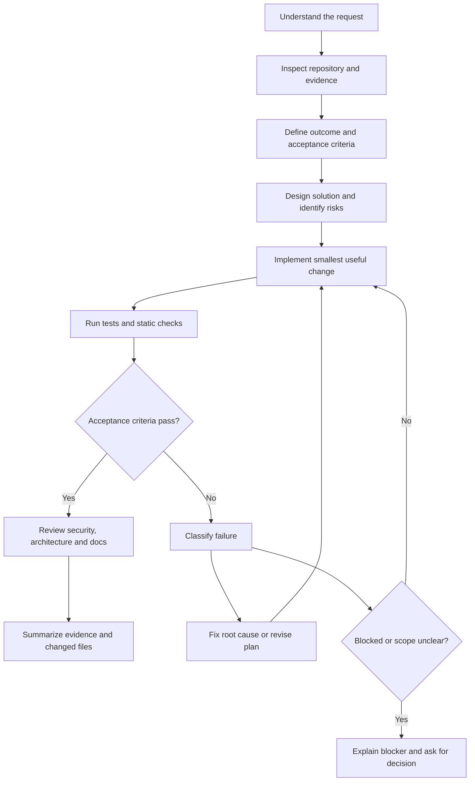
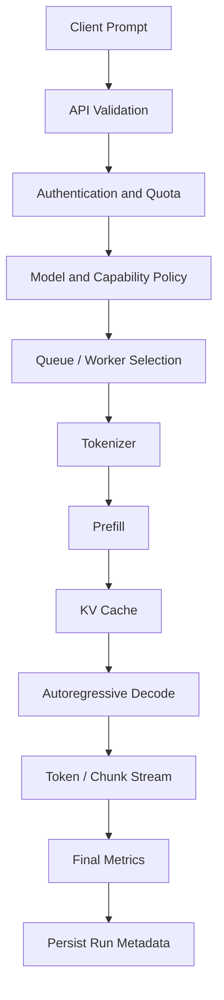
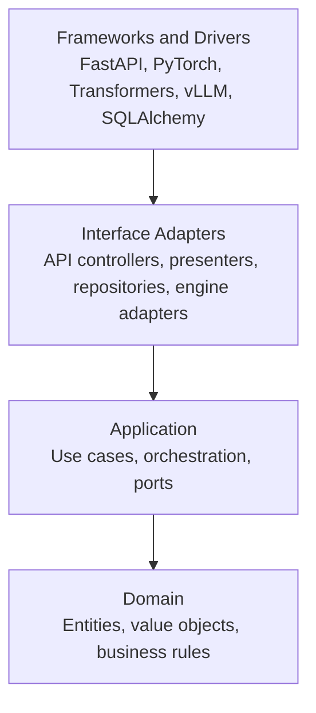

## Mandatory Security & Secrets Management Rules

Full policy: `docs/security-policy.md`. Reporting: `SECURITY.md`.

These rules are non-negotiable for every contributor, code-generation agent, branch, and commit.

### Never commit sensitive data
- NEVER commit API keys, access tokens, OAuth client secrets, passwords, private keys, signing keys, certificates containing private material, database URLs with credentials, cloud credentials, service-account files, recovery codes, or session cookies.
- NEVER commit production, staging, customer, employee, or other confidential data, including real prompts/responses, personal information, database dumps, logs, exports, or internal configuration.
- NEVER place real secrets in source code, tests, fixtures, screenshots, documentation, issue examples, sample payloads, notebooks, or commit messages.
- Do not assume a secret is safe because a repository is private, a branch is temporary, or a file is later deleted.

### Approved configuration
- Keep local secrets in ignored files such as `.env` and `.env.local`; commit only sanitized templates such as `.env.example` with placeholder values.
- Ensure `.gitignore` covers `.env*` while explicitly allowing approved templates (for example, `!.env.example`), private keys, credential files, local databases, dumps, logs, and generated secret-bearing artifacts.
- Load secrets from environment variables or an approved secret manager. Never hardcode them or expose them to frontend bundles.
- Use least-privilege credentials, separate credentials by environment, and rotate credentials periodically and after suspected exposure.
- Tests and examples must use synthetic data and unmistakable placeholders such as `REPLACE_WITH_TEST_KEY`; placeholders must not resemble usable credentials.

### Mandatory pre-commit and commit checks
Before every commit:
1. Inspect `git status` and the complete staged diff (`git diff --cached`).
2. Check staged filenames and contents for secrets, private data, credentials, and unintended generated files.
3. Run the repository's secret-scanning checks (for example, Gitleaks or an equivalent approved scanner) and relevant tests.
4. Confirm `.env`, credential files, private keys, local databases, logs, dumps, and confidential artifacts are not staged.
5. If any check fails or a file's sensitivity is uncertain, STOP. Do not commit or push until it is resolved.

Never bypass secret-scanning hooks or CI security checks to force a commit. Do not stage everything blindly with `git add .` or `git add -A` without reviewing the resulting staged changes.

### If a secret is exposed
- Treat it as compromised immediately. Revoke or rotate it at the issuing provider; deleting the file or rewriting the latest commit is not sufficient.
- Notify the repository maintainer/security owner through the approved private channel. Do not paste the exposed value into an issue, chat, commit, or remediation report.
- Remove the secret from tracked files and, where necessary, coordinate history cleanup with the maintainer. Review forks, clones, CI logs, artifacts, caches, and deployments for exposure.
- Record the incident without reproducing the secret. Re-enable and verify all security checks before resuming work.

### Enforcement
- Secret scanning must run locally before commit where practical and in CI for every pull request and protected-branch update.
- Protected branches must require passing security checks and maintainer review.
- No contributor or AI coding agent may weaken, disable, or bypass these controls without explicit maintainer approval and a documented security decision.

# CLAUDE.md — INFERX Engineering Constitution

> **Project:** INFERX — LLM Inference Engineering Platform  
> **Tagline:** Understand. Measure. Optimize.  
> **Applies to:** Every release, from `v0.1.0` through `v4.0.0` and later maintenance releases.  
> **Purpose:** Define how AI coding agents and human contributors reason about, design, implement, validate and evolve INFERX.

This file is the repository-level engineering rulebook for Claude Code. Follow it before making changes. If a task conflicts with these rules, explain the conflict and ask for clarification rather than silently weakening a requirement.

---

## 1. Mission and engineering principles

INFERX is an LLM inference engineering platform, not just a chatbot. Engineering work must improve one or more of:

- Understanding inference mechanics.
- Measuring performance accurately.
- Optimizing models and serving configurations.
- Operating inference workloads safely and reliably.
- Extending the platform through stable interfaces.

### Non-negotiable principles

1. **Understand before editing.** Inspect the repository, relevant files, tests and current architecture before changing code.
2. **Plan before implementing.** State the intended outcome, affected components, risks and verification steps.
3. **Small, reviewable changes.** Prefer focused changes over broad rewrites.
4. **Evidence over assumptions.** Run tests and inspect outputs. Never claim a test, benchmark or deployment succeeded unless it actually did.
5. **No fabricated metrics.** Sample, synthetic, estimated and measured data must be clearly distinguished.
6. **Architecture follows requirements.** Do not introduce microservices, Kubernetes, brokers or caches without a demonstrated need.
7. **Security by default.** Treat prompts, model artifacts, datasets, external content and tool output as untrusted.
8. **Documentation is part of implementation.** Update API docs, diagrams, changelog and user instructions when behavior changes.
9. **Compatibility matters.** Preserve existing API and data contracts unless a breaking change is explicitly approved.
10. **Human review remains authoritative.** AI agents may propose and implement changes, but must not self-approve protected production or security-sensitive changes.

---

# PART A — LOOP ENGINEERING

## 2. Definition

**Loop Engineering** is the disciplined, repeatable development process used to turn a requirement into a verified product capability.

It is not an uncontrolled agent loop. Each iteration has:
- A clear objective.
- A bounded scope.
- Explicit acceptance criteria.
- A measurable verification step.
- A decision to complete, refine, defer or escalate.

The loop ends when the acceptance criteria are met, a documented blocker is reached, or the task is explicitly stopped. Do not keep changing code merely to appear productive.

## 3. Standard engineering loop



### Step 1 — Understand

Before editing:
- Read this `CLAUDE.md`.
- Inspect the root README and relevant architecture documents.
- Identify the target version and feature status.
- Inspect the affected implementation and nearby tests.
- Identify existing patterns and avoid duplicating functionality.
- Clarify ambiguous requirements before making irreversible choices.

Do not assume a roadmap item is already implemented. Verify repository evidence.

### Step 2 — Define the task contract

For non-trivial tasks, record:

```text
Objective:
User-visible outcome:
Target release:
In-scope:
Out-of-scope:
Affected modules:
Acceptance criteria:
Security/privacy considerations:
Tests and verification:
Risks / open questions:
```

Keep the contract concise. For a trivial typo or isolated documentation correction, do not create unnecessary ceremony.

### Step 3 — Design

- Identify the owning domain/module.
- Define API and data-contract changes first.
- Consider failure, timeout, cancellation and overload behavior.
- Consider compatibility and migration implications.
- Identify what should be measured.
- Update or sketch the relevant graph before a cross-module change.
- Prefer the simplest design that satisfies the requirements.

### Step 4 — Implement

- Make one coherent change at a time.
- Follow the existing language, formatting and naming conventions.
- Keep route handlers thin; business logic belongs in services/domain modules.
- Keep model execution behind the inference adapter contract.
- Avoid unrelated refactors.
- Add tests with the implementation.
- Do not add dependencies without explaining why they are needed.
- Do not add placeholders that look like completed functionality.

### Step 5 — Verify

Run the narrowest relevant checks first, then broader checks when appropriate:
- Formatter and linter.
- Type checks.
- Unit tests.
- Integration/contract tests.
- Frontend build and tests.
- Security/dependency checks for relevant changes.
- Manual smoke test when automated coverage is not possible.

If a check cannot run, report:
- The exact check not run.
- Why it could not run.
- What evidence is still available.
- What remains unverified.

Never replace a failing test with a weaker assertion merely to make CI pass.

### Step 6 — Evaluate

Compare the result against every acceptance criterion:
- Does the behavior match the request?
- Are edge cases covered?
- Are failure paths safe?
- Are metrics valid?
- Are API and data contracts preserved?
- Are diagrams and docs accurate?
- Are there new security or privacy risks?

### Step 7 — Refine or finish

If a criterion fails:
1. Classify the failure: implementation defect, design defect, environment issue, unclear requirement or unsupported capability.
2. Find the root cause.
3. Update the plan if necessary.
4. Make the smallest corrective change.
5. Re-run the relevant checks.

Stop and ask for human direction when:
- Requirements conflict.
- A breaking API/schema change is needed but not authorized.
- A security boundary must be weakened.
- Credentials, paid infrastructure or external account access are required.
- The environment cannot verify a critical behavior.
- Repeated attempts do not produce new evidence.

### Step 8 — Completion report

Every non-trivial task ends with:
- What changed.
- Why it changed.
- Files/modules affected.
- Tests/checks actually run and their outcomes.
- Any checks not run.
- Known limitations or risks.
- Whether docs, diagrams and changelog were updated.
- Suggested next step, if one is genuinely useful.

Do not say “complete”, “production-ready” or “tested” without evidence appropriate to the claim.

## 4. Loop control and anti-patterns

### Required controls
- Set a finite scope for each task.
- Prefer a small number of meaningful iterations over repeated speculative edits.
- Use test failures and runtime evidence to choose the next action.
- Avoid modifying unrelated files.
- Preserve a working state; use version control checkpoints for substantial changes.
- Ask before destructive operations or irreversible data changes.

### Forbidden anti-patterns
- Repeating the same failed command without changing the hypothesis.
- Making random edits until a test passes.
- Disabling tests, lint rules or security checks to hide defects.
- Claiming benchmark improvements without controlled measurements.
- Generating large modules before validating interfaces.
- Rewriting architecture because a preferred tool is familiar.
- Continuing autonomously after scope, permissions or acceptance criteria become unclear.

---

# PART B — GRAPH ENGINEERING

## 5. Definition

**Graph Engineering** is the practice of designing, documenting and validating INFERX as a set of connected components, data flows, dependencies, states and execution paths.

A graph is not decoration. It is a model of how the software actually works.

Use graphs to answer:
- Which component owns this behavior?
- What calls or depends on it?
- Where does data enter, transform, persist and leave?
- What happens on failure, timeout, cancellation or overload?
- Which interfaces must remain stable when a component changes?
- Which graph edges are synchronous, asynchronous or streamed?

## 6. Graph types required in INFERX

### 6.1 System context graph

Shows users, external systems and the platform boundary.

Use when:
- Introducing a new external provider.
- Explaining the overall product.
- Reviewing trust boundaries and data leaving INFERX.

### 6.2 Component/dependency graph

Shows modules and allowed dependencies.

Use when:
- Adding a service, adapter or frontend feature.
- Refactoring module boundaries.
- Reviewing circular dependencies or coupling.

Rules:
- Dependencies should point toward stable domain/application contracts.
- API routes must not own model execution logic.
- Frontend components must not call model libraries directly.
- Domain logic must not depend on HTTP framework details.
- Engine-specific details stay inside adapters.

### 6.3 Data-flow graph

Shows how information is created, validated, transformed, stored and returned.

For every important flow, label:
- Data type and owner.
- Trust boundary.
- Validation or transformation.
- Persistence behavior.
- Sensitive fields and redaction.
- Sync/async/streaming behavior.

### 6.4 Inference execution graph

Shows the actual model-serving path:



Important: this is the conceptual platform flow. Update it when the actual implementation differs. Do not claim that every engine exposes internal prefill, cache or token timing telemetry.

### 6.5 State-transition graph

Use for lifecycle-managed objects:
- Model lifecycle.
- Worker lifecycle.
- Benchmark job lifecycle.
- Inference request lifecycle.
- API key lifecycle.

Every state machine must define:
- Valid states.
- Allowed transitions.
- Transition owner.
- Timeout behavior.
- Retry behavior.
- Terminal states.
- Recovery from failure.

### 6.6 Sequence graph

Use for time-ordered interactions among client, API, auth, orchestrator, worker, engine and storage. Show asynchronous boundaries, callbacks, stream events, cancellation and error paths.

### 6.7 Deployment/infrastructure graph

Shows processes, containers, networks, databases, queues, object storage and external services.

Use for:
- Environment changes.
- Production topology.
- Security review.
- Scaling and failure-domain analysis.

### 6.8 Experiment/evaluation graph

Shows inputs, controlled variables, model/engine configuration, measurements, evaluator, outputs and report artifacts. This is essential for reproducible benchmark results.

## 7. Graph engineering rules

1. **Code is the source of truth for current behavior.** A planned architecture graph must be labelled as planned.
2. **One graph, one question.** Avoid giant diagrams that combine every concern.
3. **Name nodes by responsibility.** Prefer `Inference Orchestrator` over vague names such as `Manager`.
4. **Label edges.** Use verbs such as `validates`, `dispatches`, `streams`, `persists`, `depends on`.
5. **Show boundaries.** Mark frontend/backend, API/worker, trusted/untrusted and external-provider boundaries.
6. **Show failure paths.** Include timeout, overload, worker failure and persistence failure when relevant.
7. **Show async behavior.** Distinguish HTTP calls, queue dispatch, SSE streams and background jobs.
8. **Avoid false precision.** Do not put invented latency, throughput, capacity or reliability values on diagrams.
9. **Keep diagrams maintainable.** Prefer Mermaid text in Markdown so changes are reviewable in Git.
10. **Update diagrams with code.** A PR that changes architecture must update the affected graph or explain why no graph change is needed.

## 8. Graph-to-code traceability

For a non-trivial feature, maintain this traceability chain:

```text
Requirement
   ↓
Acceptance criteria
   ↓
Domain/component graph
   ↓
API and data contracts
   ↓
Implementation modules
   ↓
Unit/contract/integration tests
   ↓
Runtime telemetry
   ↓
Documentation and release notes
```

A component in a graph should map to a real module, service, process or explicitly labelled external system. A graph edge should map to a call, event, stream, dependency or documented conceptual relationship.

If no implementation exists yet, label the node/edge `PLANNED` or `PROPOSED`.

## 9. Graph review checklist

Before merging a graph-affecting change, check:
- [ ] Does the graph answer a clear engineering question?
- [ ] Are component names and boundaries accurate?
- [ ] Are dependencies directed correctly?
- [ ] Are synchronous, asynchronous and streaming edges distinguished?
- [ ] Are data ownership and trust boundaries clear?
- [ ] Are failure, timeout and overload paths represented?
- [ ] Does every implemented node map to code or infrastructure?
- [ ] Are planned elements labelled?
- [ ] Does the graph match tests and runtime behavior?
- [ ] Is the diagram readable and maintainable?

---

# PART C — INFERX-SPECIFIC ENGINEERING STANDARDS


## 10. Clean Architecture — mandatory architectural standard

INFERX follows **Clean Architecture** as its governing code-organization and dependency model across every release. The deployment may evolve from a modular monolith to distributed services, but the dependency rule must remain intact.

### 10.1 Dependency Rule

Source-code dependencies point inward:



- Domain must not import Application, API, ORM, framework or engine-specific modules.
- Application may depend on Domain, but not on FastAPI, SQLAlchemy, PyTorch, Transformers, vLLM or cloud SDKs.
- Interface Adapters implement ports defined by inner layers and translate external formats into application/domain types.
- Infrastructure provides concrete implementations of ports and is wired at the composition root.
- Dependency inversion is achieved through interfaces/protocols owned by the inner layer.
- Runtime control flow may call outward through injected interfaces; compile-time/source dependencies still point inward.

### 10.2 Layer responsibilities

**Domain layer**
- Entities and value objects.
- Domain invariants and business rules.
- Domain events where useful.
- Pure domain policies.
- No HTTP, database, UI, framework or model-library imports.

**Application layer**
- Use cases and application services.
- Input/output DTOs or command/query models.
- Ports/interfaces for persistence, model execution, clock, event publishing and external services.
- Transaction boundaries and orchestration policy.
- No direct infrastructure implementation imports.

**Interface Adapters layer**
- HTTP controllers/routes and request/response mapping.
- Presenters and view models.
- Repository implementations or mapping adapters.
- Inference-engine adapters translating application ports to runtime APIs.
- Serialization and external protocol translation.

**Infrastructure / Frameworks layer**
- FastAPI application bootstrap and middleware.
- SQLAlchemy mappings, database sessions and migrations.
- PyTorch, Hugging Face Transformers, vLLM and tokenizer runtime integration.
- Redis, queue/broker, object storage, cloud SDKs and telemetry exporters.
- Concrete configuration and dependency-injection wiring.

### 10.3 INFERX backend target structure

```text
backend/app/
├── domain/
│   ├── models/
│   ├── inference/
│   ├── benchmarks/
│   ├── evaluation/
│   ├── workers/
│   ├── value_objects/
│   ├── policies/
│   └── exceptions.py
├── application/
│   ├── ports/
│   │   ├── inbound/
│   │   └── outbound/
│   ├── use_cases/
│   │   ├── models/
│   │   ├── inference/
│   │   ├── benchmarks/
│   │   └── evaluation/
│   ├── services/
│   └── dto/
├── adapters/
│   ├── inbound/
│   │   └── http/
│   └── outbound/
│       ├── persistence/
│       ├── inference/
│       │   ├── transformers/
│       │   └── vllm/
│       ├── queue/
│       ├── storage/
│       └── telemetry/
├── infrastructure/
│   ├── database/
│   ├── messaging/
│   ├── runtime/
│   ├── config/
│   └── observability/
├── bootstrap/
│   ├── container.py
│   └── app_factory.py
└── main.py
```

This is a logical structure, not a mandate to create empty packages. Add modules when a real use case needs them. Keep the composition root explicit and small.

### 10.4 INFERX frontend boundary

Apply the same dependency principle in the React application, scaled appropriately for a frontend:

- **Domain:** framework-independent types, rules and calculations.
- **Application:** feature use cases, state orchestration and ports.
- **Adapters:** API clients, DTO mappers and state/presenter adapters.
- **Presentation:** React components, pages, hooks and UI-specific view models.
- **Infrastructure:** browser-facing implementations and configuration.

React components must not contain benchmark formulas, inference business rules or direct engine/runtime concerns. Keep feature modules cohesive and avoid creating abstract layers for trivial UI behavior.

### 10.5 Ports and adapters examples

Application-owned ports should describe what the use case needs, not how a vendor implements it.

Examples:
- `ModelExecutionPort`
- `ModelCatalogPort`
- `InferenceRequestRepository`
- `BenchmarkRunRepository`
- `JobQueuePort`
- `ClockPort`
- `ArtifactStoragePort`
- `TelemetryPort`

Concrete implementations belong in outer layers:
- `TransformersInferenceAdapter`
- `VLLMInferenceAdapter`
- `SqlAlchemyInferenceRequestRepository`
- `PostgresBenchmarkRunRepository`
- `RedisJobQueueAdapter`
- `SystemClockAdapter`

Do not make Domain or Application import these concrete classes.

### 10.6 Composition root and dependency injection

- Construct concrete adapters in `bootstrap/` or the application composition root.
- Inject ports into use cases.
- Keep dependency wiring out of domain entities and business rules.
- Do not use service locators or global mutable singletons as a shortcut.
- Ensure tests can inject fakes/in-memory implementations.
- Keep configuration parsing at the outer boundary and pass validated settings inward.

### 10.7 Clean Architecture enforcement

For every cross-layer change:
- [ ] Identify the owning layer.
- [ ] Check that dependencies point inward.
- [ ] Define or reuse an inner-layer port when an outer capability is needed.
- [ ] Keep framework/runtime types out of domain entities and use-case contracts.
- [ ] Wire concrete implementations only at the composition root.
- [ ] Add unit tests for domain/use-case behavior without infrastructure.
- [ ] Add adapter contract/integration tests for concrete implementations.
- [ ] Check for circular imports and hidden framework coupling.
- [ ] Update component/dependency graphs if boundaries change.

Use automated import-boundary checks where practical. A test that only verifies the application starts is not sufficient evidence of architectural compliance.

### 10.8 Avoid architecture theatre

Clean Architecture is not a reason to create an interface for every class, duplicate every DTO, or split every function into another package.

Create an abstraction when it protects a meaningful boundary, enables substitution/testing, isolates a volatile dependency or expresses a real domain contract. Keep simple, stable code simple.

The modular monolith remains the default deployment shape until scale, fault isolation or independent release needs justify distribution. Microservices do not automatically make an architecture cleaner.


## 11. Architecture and code boundaries

- Use a modular monolith until measured scale or isolation requirements justify distribution.
- Keep API handlers thin.
- Put use cases in application services.
- Keep domain types independent from FastAPI and database implementation details.
- Use repository interfaces for persistence boundaries.
- Keep model execution behind `InferenceAdapter`.
- Keep engine-specific behavior inside its adapter.
- Keep benchmark orchestration separate from request-serving paths.
- Keep long-running GPU work out of the API event loop.
- Do not add Redis, Kafka, Kubernetes or microservices without a documented requirement and trade-off.

## 12. Inference correctness and metrics

Use a monotonic high-resolution clock such as `time.perf_counter_ns()`.

Definitions:
- `TTFT = first_output_token_time - documented_request_start`
- `TPOT = (last_token_time - first_token_time) / (output_tokens - 1)` when output tokens > 1
- `Decode TPS = (output_tokens - 1) / (last_token_time - first_token_time)` when denominator > 0
- For one output token, TPOT and decode TPS are `null`, not zero.
- Client-observed latency is not the same as server-side latency.
- Document whether TTFT includes queue wait, tokenization and scheduling.
- Preserve raw measurements and benchmark configuration.
- Report p50/p95/p99 only with sample count and percentile method.
- Do not publish sample or estimated metrics as real measurements.

Benchmark metadata must include model revision, tokenizer, engine/version, hardware, software versions, precision, prompt/output token counts, warm-up count, measured runs, concurrency, configuration and limitations.

## 13. Model and runtime safety

- Use approved model IDs and pinned revisions where practical.
- `trust_remote_code=False` by default.
- Do not accept arbitrary model IDs from unauthenticated users.
- Never execute user-provided Python or shell code.
- Validate prompt, context and output-token limits.
- Bound queues and concurrency.
- Protect shared model lifecycle state.
- Do not unload a model during active inference.
- Document adapter capabilities; never pretend unsupported runtime controls work.
- Treat model cards, model files, datasets and external tool output as untrusted data.

## 14. Security and privacy

- Never commit secrets, `.env`, credentials, private data or model weights.
- Do not log full prompts or generated content by default.
- Use secret management for deployed credentials.
- Validate inputs and enforce rate limits/quotas.
- Apply authentication and authorization before multi-user public hosting.
- Keep tenant data isolated.
- Store API key hashes, not plaintext keys.
- Review dependency and model licenses separately.
- Do not weaken security controls to make a demo easier.

## 15. Version-aware implementation

Use the master implementation guide as the release roadmap.

- `v0.x`: foundation, inference mechanics and basic API.
- `v1.x`: core learning platform, reliability and visualizations.
- `v2.x`: reproducible benchmarking, optimization, evaluation and worker foundations.
- `v3.x`: multi-engine extensibility, community ecosystem and enterprise-readiness foundations.
- `v4.0.0`: production-ready identity, tenant isolation, worker operations, observability, security, recovery and release gates.
- `v4.0.x+`: maintenance and backward-compatible evolution.

Before implementing a feature:
1. Identify its target version.
2. Check whether it is already implemented.
3. Avoid pulling future-version complexity into an earlier milestone unless required.
4. Update the roadmap/status only when code and tests provide evidence.
5. Do not call the project production-ready until all v4.0 release gates pass in a specified environment.

## 16. Testing expectations

Choose tests based on the change:
- Unit tests for formulas, validation, state transitions and domain behavior.
- Adapter contract tests for engine compatibility.
- Integration tests for API/database/worker boundaries.
- Frontend tests for user flows and error states.
- End-to-end tests for streamed inference.
- Performance tests for latency, throughput and saturation.
- Security tests for authentication, authorization, tenant isolation and input limits.
- Resilience tests for worker crash, timeout, queue full, DB outage and disconnect.

Never disable or weaken a test solely to obtain a green build.

## 17. Documentation expectations

Update relevant documentation whenever behavior changes:
- README for user-visible setup or feature changes.
- API docs for contract changes.
- Architecture graphs for component/data-flow changes.
- Experiment docs for benchmark methodology changes.
- Security docs for trust-boundary or data-handling changes.
- `CHANGELOG.md` for release-facing changes.
- Master guide only when long-term product architecture or roadmap changes.

## 18. Git and change management

- Use focused commits and descriptive messages.
- Do not rewrite shared history unless explicitly requested.
- Do not force-push protected branches.
- Do not delete or overwrite user work without explicit approval.
- Do not commit generated secrets, local databases, model caches or large artifacts.
- Keep PRs focused and include tests, docs and graph updates as applicable.
- The repository maintainer controls merges and releases.

## 19. Definition of done

A task is done only when:
- Acceptance criteria are met.
- Implementation follows module boundaries.
- Relevant tests pass, or unrun checks are explicitly disclosed.
- Failure and edge cases are considered.
- Security/privacy implications are reviewed.
- Relevant graphs and docs are updated.
- No unsupported capability or fabricated metric is presented.
- The completion report lists evidence and remaining limitations.

---

## 20. Agent response format

For substantial work, report in this format:

```text
## Summary
What changed and why.

## Engineering loop
- Requirement and acceptance criteria:
- Design decision:
- Implementation:
- Evaluation/refinement:

## Graph impact
- Graphs added/updated:
- Component/data-flow changes:
- Failure paths considered:

## Verification
- Commands/tests run:
- Results:
- Checks not run:

## Risks and limitations
Known gaps, assumptions or blockers.

## Release impact
Target version and changelog/status impact.
```

For small changes, use a shorter summary; do not create unnecessary process overhead.

**Final rule:** INFERX engineering is complete only when the behavior is implemented, the evidence is checked, and the architecture remains understandable.
