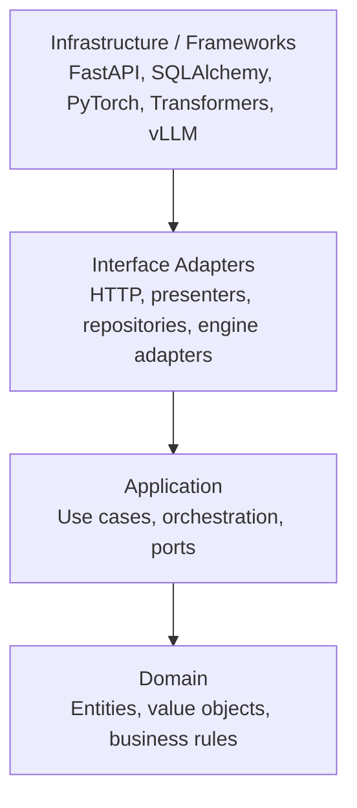
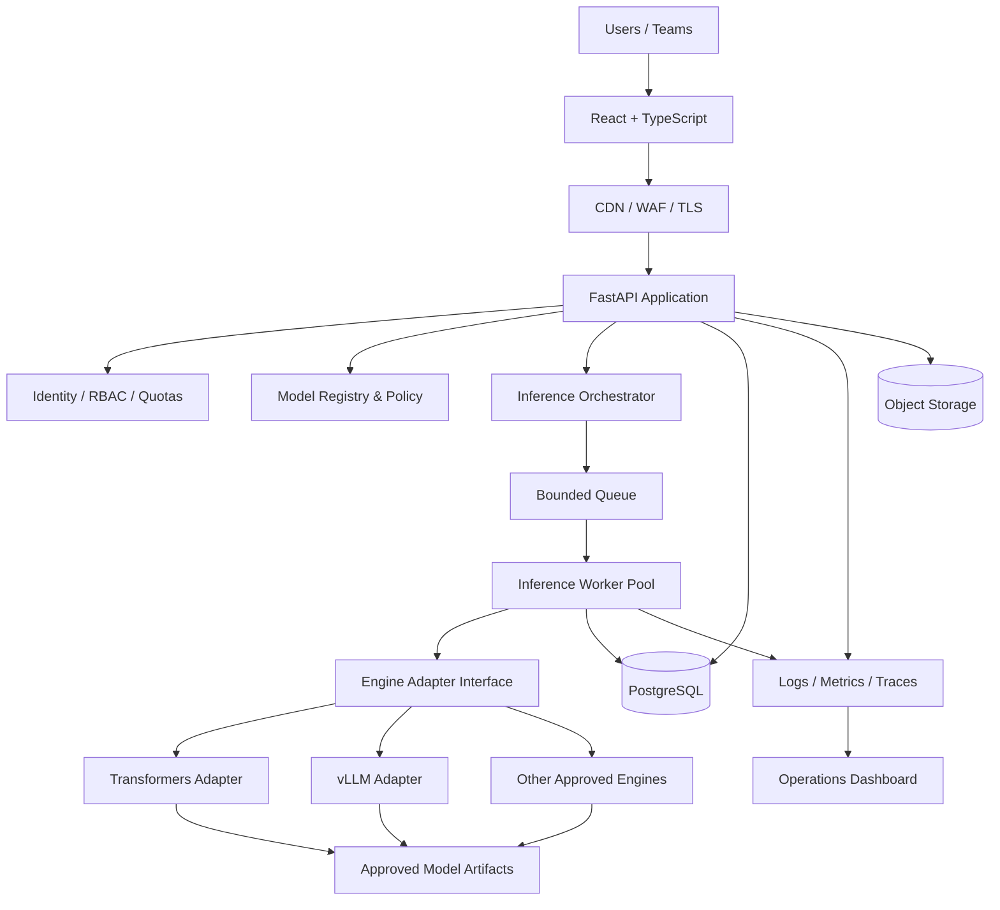
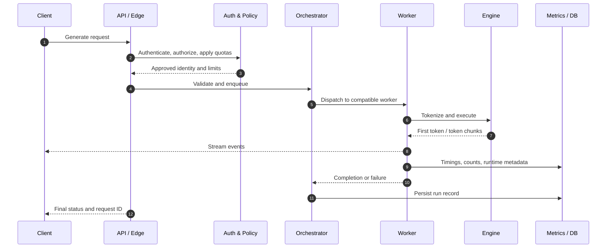
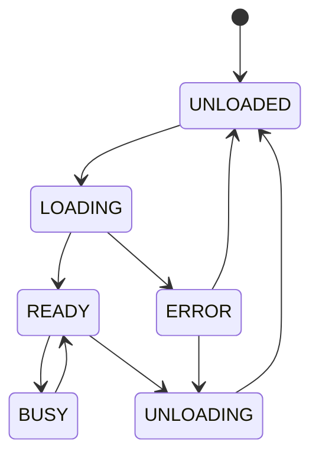

# INFERX — Master Product & Engineering Implementation Guide

**Product:** INFERX — LLM Inference Engineering Platform  
**Tagline:** Understand. Measure. Optimize.  
**Scope:** Complete product lifecycle from `v0.1.0` through final production target `v4.0.0` and later maintenance releases.

> This is the master blueprint for the complete product, not an MVP-only guide. Roadmap items are targets, not claims that features are already implemented. Track each item as PLANNED, IN_PROGRESS, IMPLEMENTED, TESTED, RELEASED or DEFERRED.

## 1. Product vision

INFERX is an open-source engineering platform to understand, inspect, measure, compare and optimize LLM inference and model serving. It is not merely a chatbot.

### Mission
1. Explain inference internals through visualizations.
2. Measure performance using repeatable experiments.
3. Make optimization decisions evidence-based.
4. Compare models and serving engines through common interfaces.
5. Enable reviewed community contributions.

### Users
LLM/ML engineers, AI solution and platform architects, backend engineers, students, researchers and open-source contributors.

### Product modules
1. Overview Dashboard
2. Model Registry
3. Model Playground
4. Inference Visualizer
5. Benchmark Lab
6. Optimization Lab
7. Evaluation Lab
8. Observability
9. Reports and History
10. Administration and Workspace Management
11. Developer and Contributor Hub

### Product principles
- Measure before making performance claims.
- Preserve raw measurements and reproducibility metadata.
- Distinguish conceptual explanations from runtime telemetry.
- Make safe defaults the default.
- Keep modules extensible through interfaces.
- Begin with a modular monolith; distribute components only when justified.
- Clearly label demo/sample data and live inference.

### Non-goals unless separately approved
Training foundation models, arbitrary user-supplied code execution, unrestricted arbitrary model loading, guaranteed free GPU capacity, and premature Kubernetes/microservices adoption.

## 2. Requirements and quality attributes

### Functional requirements
- Discover approved models and inspect revisions, capabilities and licenses.
- Load, warm, unload and monitor models.
- Tokenize prompts and estimate token counts.
- Generate and stream responses.
- Capture timings, token counts and runtime metadata.
- Run controlled benchmark and evaluation experiments.
- Compare models, engines and configurations.
- Persist experiment metadata and raw observations.
- Visualize inference stages, performance distributions and resource usage.
- Export reproducible reports.
- Provide authenticated, role-based access and quotas in production.

### Non-functional requirements

| Area | Requirement |
|---|---|
| Correctness | Tested formulas, token counts, state transitions and API contracts |
| Performance | Measured latency, throughput and tail distributions |
| Reliability | Bounded queues, timeouts, graceful failure and recovery |
| Security | Authentication, authorization, validation, secret management and audit |
| Scalability | Independent API/worker scaling when required |
| Observability | Structured logs, metrics, traces and correlation IDs |
| Reproducibility | Model revisions, configs, hardware and software metadata |
| Accessibility | Keyboard navigation, semantic controls and readable charts |
| Maintainability | Modular boundaries, typed contracts, tests and documentation |

Define SLOs only after measuring a representative workload. Specify availability, API latency, inference TTFT/TPOT, error budget, queue-wait limit and recovery objectives. Never invent universal performance targets.

## 3. Architecture evolution
### Clean Architecture — mandatory across all releases

INFERX follows Clean Architecture from the prototype through the production target. Deployment may evolve from a modular monolith to distributed services, but source-code dependencies must continue to point inward.



**Domain:** entities, value objects, invariants, domain policies and domain exceptions. No framework, ORM, HTTP or ML-runtime imports.

**Application:** use cases, orchestration, input/output contracts and ports. It depends on Domain and abstractions, never concrete infrastructure.

**Interface Adapters:** HTTP controllers, presenters, DTO mapping, repository adapters and inference-engine adapters.

**Infrastructure / Frameworks:** FastAPI bootstrap, SQLAlchemy/PostgreSQL, PyTorch, Transformers, vLLM, queues, storage, cloud SDKs and telemetry exporters.

Rules:
1. Dependencies point inward. Runtime calls may flow outward through injected ports, but source imports must not point from inner layers to outer layers.
2. Define ports in Domain or Application according to ownership; implement them in outer adapter/infrastructure layers.
3. Wire concrete dependencies in a small composition root.
4. Keep framework, ORM and engine-specific types out of domain entities and application use-case contracts.
5. Keep API routes thin; translate transport requests and invoke use cases.
6. Test Domain and Application without databases, HTTP frameworks or GPU runtimes.
7. Test concrete adapters with contract and integration tests.
8. Avoid interfaces and packages that add ceremony without protecting a real boundary.

Suggested backend layout:

```text
backend/app/
├── domain/
├── application/
│   ├── ports/{inbound,outbound}/
│   ├── use_cases/
│   ├── services/
│   └── dto/
├── adapters/
│   ├── inbound/http/
│   └── outbound/{persistence,inference,queue,storage,telemetry}/
├── infrastructure/{database,messaging,runtime,config,observability}/
├── bootstrap/{container.py,app_factory.py}
└── main.py
```

Create packages when actual capabilities require them; do not create empty layers pre-emptively. Apply the same dependency direction to the React frontend at an appropriate scale: framework-independent domain rules, application orchestration, API/state adapters and React presentation. React components must not own inference or benchmark business rules.


| Release stage | Architecture | Rationale |
|---|---|---|
| v0.x–v1.1 | Modular monolith | Fast iteration and simple operation |
| v1.2–v2.2 | Modular monolith with stronger interfaces/background jobs | Add capability without premature distribution |
| v2.3–v3.x | API plus isolated inference/benchmark workers as justified | GPU isolation and multiple engines |
| v4.0 | Production topology with independently scalable services | Security, reliability and operations |

### Logical architecture



### Runtime sequence



### Domain boundaries
- Identity and Access: users, roles, API keys, quotas, audit.
- Model Catalog: model IDs, revisions, licenses, tasks and constraints.
- Runtime: model lifecycle and engine-specific execution.
- Orchestration: scheduling, queues, cancellation and worker selection.
- Experimentation: benchmarks, controlled runs and comparisons.
- Evaluation: datasets, evaluators, scores and trade-offs.
- Telemetry: timings, resource metrics, logs and traces.
- Reporting: queries, visualizations and exports.

## 4. Technology stack

| Layer | Initial | Later / production |
|---|---|---|
| Web | React, TypeScript, Vite | Same, CDN delivery |
| UI/charts | Tailwind CSS, Recharts | Accessible component system |
| API | FastAPI, Pydantic | FastAPI behind gateway |
| Runtime | Python, PyTorch | Dedicated GPU worker images |
| Model library | Hugging Face Transformers | vLLM and approved adapters |
| Tokenizer | Transformers / Tokenizers | Engine-native tokenizer where needed |
| Database | SQLite | PostgreSQL |
| ORM/migrations | SQLAlchemy, Alembic | Same |
| Queue | Bounded in-process queue | Redis/broker only when needed |
| Cache | None initially | Redis for justified short-lived state |
| Object storage | Local files | S3-compatible storage |
| Streaming | SSE | SSE; WebSocket only if bidirectional needs exist |
| Tests | pytest and frontend test tools | Load, security, end-to-end |
| CI/CD | GitHub Actions | Environment approvals and rollback |
| Observability | Structured logs/basic metrics | OpenTelemetry-compatible telemetry |
| Deployment | Static frontend, optional demo backend | Managed API, DB and GPU workers |

**Zero-budget constraint:** ₹0 is realistic for source development, documentation, static hosting and limited notebook experiments. Free GPU runtimes have quotas and availability can change. Reliable GPU capacity, uptime, WAF, managed database, storage and production monitoring may cost money. Keep a demo mode with explicitly labelled sample data.

## 5. Repository structure

```text
inferx/
├── frontend/src/{app,components,features,services,hooks,types,utils}/
├── backend/app/
│   ├── api/v1/  ├── core/  ├── identity/  ├── schemas/  ├── domain/
│   ├── services/{registry,loader,tokenizer,inference,orchestration,streaming,benchmark,evaluation,optimization,reporting}/
│   ├── adapters/{base.py,transformers/,vllm/}
│   ├── workers/  ├── monitoring/  ├── repositories/  ├── database/
│   └── main.py
├── backend/migrations/  ├── backend/tests/
├── experiments/{definitions,notebooks}/
├── benchmark-results/  ├── deployment/{docker,compose,environments}/
├── docs/  ├── scripts/  ├── .github/{ISSUE_TEMPLATE,workflows}/
├── README.md  ├── MASTER_IMPLEMENTATION_GUIDE.md
├── CONTRIBUTING.md  ├── CODE_OF_CONDUCT.md
├── SECURITY.md  ├── CHANGELOG.md  ├── LICENSE
└── .gitignore
```

Keep notebooks exploratory; move reusable, tested logic into backend modules.

## 6. Model registry and lifecycle

Record canonical model ID, provider, immutable revision, architecture/task, tokenizer, context window, license/model-card URL, supported engines, hardware constraints, precision/quantization support, artifact source and approval status.

Model code license and weights license are separate. Verify both before redistribution or hosting.

Start with one small model, e.g. `HuggingFaceTB/SmolLM2-360M-Instruct`, after checking its model card, license, revision and hardware fit. Do not load multiple models simultaneously on an 8 GB laptop. Use cloud notebooks when available; GPU availability is not guaranteed.

Lifecycle states:



Rules: never unload during active inference; enforce load timeouts and memory checks; track revisions/config; start with one active model and controlled generation; add concurrent residency only after measuring memory and workload.

## 7. Inference engine abstraction

The application must not depend directly on a single runtime's internal API.

```python
from typing import Protocol, Iterator


class InferenceAdapter(Protocol):
    def load(self, model_spec, runtime_config) -> None: ...
    def unload(self) -> None: ...
    def tokenize(self, prompt: str) -> dict: ...
    def generate(self, prompt: str, config) -> "GenerationResult": ...
    def stream(self, prompt: str, config) -> Iterator["TokenEvent"]: ...
    def health(self) -> dict: ...
    def capabilities(self) -> dict: ...
```

- `TransformersAdapter`: first implementation and learning baseline.
- `VLLMAdapter`: later throughput-oriented engine where compatible infrastructure exists.
- Additional adapters: only with a documented use case and contract tests.

Capability metadata must say whether streaming, cancellation, KV-cache controls, batching, quantization and token timestamps are genuinely supported. Never silently emulate unsupported capabilities.

Run synchronous model execution outside FastAPI's event loop. Use controlled workers, protect model state, bound queue length, enforce token/context/time limits, support graceful shutdown and isolate GPU worker crashes where practical.

## 8. Metrics and benchmark methodology

### Metric definitions

| Metric | Definition |
|---|---|
| Prompt tokens | Input tokens under the selected tokenizer |
| Output tokens | Number of generated tokens |
| TTFT | First output token time minus documented server request start |
| TPOT | `(last_token_time - first_token_time) / (output_tokens - 1)` when output tokens > 1 |
| Decode TPS | `(output_tokens - 1) / (last_token_time - first_token_time)` when denominator > 0 |
| E2E server latency | Server completion minus server request start |
| Queue wait | Worker start minus enqueue timestamp |
| Prefill duration | End of prefill minus start, only if engine exposes valid boundaries |
| Inter-token latency | Time between token/chunk events |
| Resource usage | CPU, RAM, GPU utilization and GPU memory when available |

Use `time.perf_counter_ns()` or another monotonic high-resolution clock.

Rules:
- Document whether TTFT includes validation, queue wait, tokenization and scheduling.
- Record separate timestamps to support different latency scopes.
- For one output token, TPOT and decode TPS are `null`, not zero.
- Client-observed latency differs from server-side timing.
- Do not claim prefill timing if the adapter cannot expose it.
- Clarify whether stream chunks represent individual tokens or grouped chunks.
- Report p50/p95/p99 with sample count and percentile method.
- Preserve raw observations; do not store only aggregates.
- Label synthetic/demo metrics.

Each benchmark captures experiment version, model revision/tokenizer, engine/version, hardware, OS and runtime versions, precision/quantization, prompt identity or hash, token counts, generation config, warm-ups, repetitions, concurrency, batch/queue settings, raw timestamps, failures, aggregation method and limitations.

## 9. Experiment curriculum

Every experiment includes question, hypothesis, controlled variables, procedure, raw data, analysis, limitations and reproduction metadata.

| ID | Experiment | Learning outcome |
|---|---|---|
| E01 | Tokenization | Tokenizer differences and truncation |
| E02 | Prefill vs decode | Prompt processing versus autoregressive generation |
| E03 | KV cache on/off | Cache impact where supported |
| E04 | Sampling | Temperature, Top-K, Top-P, repetition penalty, stop sequences |
| E05 | Streaming | TTFT and inter-token latency |
| E06 | Model comparison | Quality/performance/cost trade-offs |
| E07 | Precision/quantization | FP32, FP16, BF16, INT8, INT4 where supported |
| E08 | Batching | Sequential, static and continuous batching |
| E09 | Context length | Memory and latency impact |
| E10 | Engine comparison | Transformers versus vLLM or other supported engine |
| E11 | Concurrency/queueing | Throughput, queue wait, saturation and tail latency |
| E12 | Prefix caching | Cache hits and correctness constraints |
| E13 | Speculative decoding | Draft/target trade-offs if supported |
| E14 | Evaluation trade-offs | Quality changes after optimization |
| E15 | Cost modeling | Cost per request/token with explicit assumptions |
| E16 | Failure recovery | Worker crash, timeout, overload and restart |

## 10. API design

Base path: `/api/v1`. Use Pydantic schemas, OpenAPI, request IDs and stable error envelopes.

**Models**
- `GET /models`
- `GET /models/{model_id}`
- `POST /models/load`
- `POST /models/unload`
- `GET /models/status`
- `GET /models/{model_id}/capabilities`

**Inference**
- `POST /inference/generate`
- `POST /inference/stream` (SSE)
- `POST /inference/tokenize`
- `POST /inference/estimate`
- `GET /inference/{request_id}`
- `POST /inference/{request_id}/cancel` (only where supported)

**Benchmarks/evaluation**
- `POST /benchmarks/run`
- `GET /benchmarks`
- `GET /benchmarks/{run_id}`
- `POST /benchmarks/compare`
- `DELETE /benchmarks/{run_id}`
- `POST /evaluations/run`
- `GET /evaluations/{run_id}`

**Metrics/operations**
- `GET /metrics/latest`
- `GET /metrics/history`
- `GET /system/resources`
- `GET /health`
- `GET /ready`
- `GET /workers`
- `GET /workers/{worker_id}`

**Production identity/admin**
- OIDC-based login/refresh integration, `GET /me`
- Admin user/role/quotas endpoints
- Audit event query endpoint

Prefer a reputable identity provider/OIDC integration over custom password handling.

Suggested stable error codes: `MODEL_NOT_FOUND` (404), `MODEL_NOT_READY`/`MODEL_LOADING` (409), `INVALID_CONFIG` (422), `UNAUTHENTICATED` (401), `FORBIDDEN` (403), `QUEUE_FULL`/`RATE_LIMITED` (429), `RESOURCE_EXHAUSTED` (503), `REQUEST_TIMEOUT` (504), `INFERENCE_FAILED` (500). Never expose stack traces, secrets or internal paths.

SSE event types: `metadata`, `token`, `metrics`, `error`, `done`. Include keep-alives as required by proxies. Handle client disconnects deliberately; a disconnect does not automatically guarantee GPU work stops.

## 11. Database and retention

Core entities:
- `users`, `roles`, `api_keys`
- `model_catalog`, `model_revisions`, `workers`
- `inference_requests`, `metric_samples`
- `experiments`, `benchmark_runs`, `benchmark_observations`
- `evaluation_runs`, `evaluation_scores`
- `audit_events`, `quotas`, `saved_reports`

Storage progression:
- v0.x–v1.x: SQLite single-instance learning/demo.
- v2.x: migrations and repository boundaries; PostgreSQL compatibility.
- v3.x: PostgreSQL for multi-user/worker coordination.
- v4.0: production database with backups, restore drills and retention controls.

Redis is optional, not mandatory. Do not persist raw prompts by default. Make prompt retention explicit opt-in; redact logs; define deletion/export/retention; protect datasets and reports; store API-key hashes, never plaintext secrets.

## 12. Frontend experience

Navigation: Overview, Model Registry, Playground, Inference Visualizer, Benchmark Lab, Optimization Lab, Evaluation Lab, Observability, Reports, Administration (authorized users), Documentation.

Key screens:
- Dashboard: model/worker status, recent measured runs, metrics, demo banner.
- Registry: approved model, revision, license, capabilities, compatibility.
- Playground: prompt, generation config, token estimate, streaming and metrics.
- Visualizer: tokenization, prefill/decode, cache and token/chunk timeline.
- Benchmark: controlled setup, warm-up/repetition, progress, failure and distributions.
- Optimization: before/after performance and quality trade-offs.
- Evaluation: dataset/evaluator provenance, scores and failure examples.
- Observability: request lookup, queue wait, worker status, errors and resources.
- Reports: reproducible configs and CSV/JSON exports.
- Administration: users, roles, quotas, policies and audit.

UX requirements: responsive, keyboard accessible, semantic labels, accessible chart summaries, clear loading/empty/error states, visible distinction between measured/estimated/illustrative values, and metric definitions beside charts.

## 13. Security, privacy and governance

Security is required from the first public deployment.

- Validate prompt length, token limits, model ID and generation parameters.
- Allowlist model IDs/revisions.
- `trust_remote_code=False` by default; review any exception.
- Never accept arbitrary Python, shell commands, model-loading code or user file paths.
- Require authentication/authorization before multi-user hosted access.
- Apply per-user/IP rate limits, quotas and bounded concurrency.
- Protect against SSRF, injection, unsafe URL fetching and request abuse.
- Restrict CORS; use TLS; secure headers; CSRF protection when cookie auth requires it.
- Pin dependencies, scan vulnerabilities, run containers non-root and least privilege.
- Restrict worker filesystem/network access.
- Treat prompts, model artifacts and datasets as untrusted inputs.
- Never commit `.env`, credentials, private data or model weights.
- Use secret manager/protected CI secrets; rotate leaked credentials.
- Generate SBOM where practical; pin base images and verify artifact origin.
- Review model and dataset licenses separately from repository code license.
- Publish privacy, acceptable-use, incident-response and model-limitation documentation before hosted public access.
- Audit administrative actions and define model-disable procedures.

## 14. Testing and quality

Test layers:
1. Unit: metric formulas, validation, lifecycle, config, repositories.
2. Adapter contract: common behavior and declared capabilities.
3. Integration: API, database, queue and workers.
4. Frontend: components, state, forms and error states.
5. End-to-end: model selection to streamed completion.
6. Performance: controlled concurrency, latency distribution and saturation.
7. Security: auth, authorization, quotas, input bounds and dependency scans.
8. Resilience: worker restart, timeout, queue full, DB unavailable, disconnect.
9. Accessibility: keyboard, focus, semantics and contrast.

Required correctness tests:
- One-token output gives null TPOT/decode TPS.
- Token count uses selected tokenizer/revision.
- TTFT boundary is tested.
- Unsupported capabilities are reported honestly.
- Model cannot unload during active inference.
- Queue limit is enforced.
- Tenant A cannot access Tenant B reports.
- Prompt content is not logged by default.
- Demo data is labelled.
- Percentiles include sample count and method.

CI should run formatting, linting, type checks, tests, frontend build, dependency/secret scans, container checks and documentation checks. Production releases add migration, smoke, rollback, load and security checks.

## 15. Deployment and operations

### Development/demo
Static frontend hosting (e.g. GitHub Pages), local or limited backend hosting, optional notebook GPU runtime and explicit demo mode. Do not promise continuous free GPU access.

### Production topology
- CDN/WAF and TLS ingress/API gateway.
- Stateless API replicas.
- Identity provider.
- PostgreSQL and tested migrations.
- Bounded queue/broker only when justified.
- Separate inference worker pools by engine/model/hardware.
- Object storage for reports/artifacts.
- Centralized logs, metrics and traces.
- Secret management, image scanning and CI/CD.
- Staging/production environments and rollback.

Kubernetes is optional; adopt only if scale and operational requirements justify it.

`/health` should indicate process liveness. `/ready` should indicate readiness for traffic and required dependencies. Workers expose model readiness, engine responsiveness, memory headroom and last successful operation. On shutdown, stop new work and drain/terminate in-flight work according to policy.

Define RPO/RTO, automate database backups, test restore, version deployment artifacts and document rollback.

## 16. Observability and incident response

Every request has a correlation ID. Structured logs include safe lifecycle timestamps, model/revision, engine, safe config metadata, worker, queue wait, token counts, terminal status and error code. Do not log full prompts or generated content by default.

Track request/error rates, TTFT/TPOT/E2E distributions, token rates, queue depth/wait, worker health, load/unload duration, CPU/RAM/GPU usage, timeouts, cancellations and resource exhaustion.

Alert thresholds must come from baseline measurements. Maintain runbooks for diagnosis, mitigation, escalation and post-incident review.

## 17. Open-source contribution model

Welcome contributions in backend, adapters, experiments, frontend, diagrams, docs, tests, security and deployment.

Contribution flow:
1. Contributor opens/selects issue.
2. Scope and acceptance criteria are agreed.
3. Fork and feature branch.
4. Implement with tests/docs.
5. Open PR.
6. CI runs.
7. Maintainer reviews correctness, architecture, security and licensing.
8. Maintainer approves/requests changes and controls merge/release.

Repository governance: `LICENSE` (Apache-2.0 if owner confirms), `CONTRIBUTING.md`, `CODE_OF_CONDUCT.md`, `SECURITY.md`, `CHANGELOG.md`, issue/PR templates, branch protection and review rules. Public repository does not mean automatic acceptance. Model weights/dataset rights are separate from code license.

## 18. Complete version roadmap: v0.1.0 to v4.0.0

### v0.1.0 — Foundation prototype
Deliver: public repo, environment/lockfile, one small approved model, tokenizer, basic Transformers generation, minimal FastAPI, health endpoint, config, logs and unit tests.  
Exit: documented environment loads model, tokenizes and generates; failures do not crash process.

### v0.2.0 — Inference mechanics
Deliver: token counts, generation config, supported sampling controls, prefill/decode explanation, KV-cache explanation/telemetry where supported, initial timings and notebooks.  
Exit: metric boundaries documented; conceptual values never masquerade as runtime measurements.

### v0.3.0 — API and streaming
Deliver: typed schemas, generate/tokenize endpoints, SSE, request IDs, terminal events, input/output limits, controlled execution and integration tests.  
Exit: client receives stream and terminal event; errors stable; concurrency bounded.

### v1.0.0 — Core INFERX learning platform
Deliver: React/TypeScript, dashboard, playground, visualizer, model lifecycle controls, SSE, TTFT/TPOT/decode TPS/E2E, SQLite, basic benchmark history/comparison, labelled demo mode, docs, architecture and CI.  
Exit: fresh setup works from docs; live/demo are distinct; run config/environment is reproducible; core flows tested.

### v1.1.x — Reliability and usability
Deliver: lifecycle state machine, load/unload timeout, bounded queue, overload response, graceful shutdown, supported cancellation, validation, exports, filters, pagination, pinned dependencies and CI gates.  
Exit: no unbounded queue; lifecycle consistency tested; limitations documented.

### v1.2.x — Interactive inference learning
Deliver: token timeline, prefill/decode and KV-cache visualization, sampling playground (temperature, Top-K, Top-P, repetition penalty, stop sequences), context experiment, glossary and accessibility.  
Exit: conceptual/runtime data clearly separated; unsupported controls disabled with explanation.

### v2.0.0 — Performance engineering lab
Deliver: benchmark protocol, warm-ups, repetitions, raw observations, p50/p95/p99 with sample count, model/config comparison, context/KV experiments, precision/quantization where supported, resource capture and report export.  
Exit: complete environment/config metadata, failures visible, reproducible runs and no fabricated claims.

### v2.1.x — Advanced serving foundations
Deliver: adapter contract, Transformers contract tests, experimental vLLM adapter where hardware allows, capability discovery, concurrency/batching experiments and worker isolation prototype.  
Exit: same API routes supported adapters; capabilities explicit; unsupported features fail safely.

### v2.2.x — Evaluation and observability
Deliver: dataset/evaluator interfaces, quality/performance comparison, structured logs, correlation IDs, basic traces/resources, failure analysis and reproducibility manifests.  
Exit: dataset provenance/license and evaluator limitations documented.

### v2.3.x — Worker and job execution
Deliver: separate benchmark worker, job lifecycle, bounded retries, heartbeats, queue policies, API/worker deployment split and PostgreSQL compatibility.  
Exit: worker failure does not take API down; retries bounded; duplicate-job semantics defined.

### v3.0.0 — Extensible multi-engine platform
Deliver: multiple adapters, model capability registry, worker pools by engine/model/hardware, background jobs, PostgreSQL multi-user data model, API compatibility policy, experiment extension specification and operator docs.  
Exit: new adapter does not require unrelated domain/UI rewrites; capability matching and migrations tested.

### v3.1.x — Community ecosystem
Deliver: contributor experiment template, adapter SDK/examples, plugin registration/compatibility checks, docs portal, community benchmark format and curated catalog.  
Exit: external contributors can build/test extensions; extensions validated before activation; benchmark provenance preserved.

### v3.2.x — Advanced optimization
Deliver: prefix/prompt caching, speculative decoding where supported, advanced batching/concurrency, quantization matrix, cost estimates with assumptions, regression comparisons and optional distributed-worker experiments.  
Exit: correctness/evaluation accompanies optimization; costs are estimates with assumptions.

### v3.3.x — Enterprise-readiness foundations
Deliver: OIDC integration, RBAC/tenant ownership, per-user/API-key quotas, audit events, retention/deletion, threat model, environment separation and backup/restore procedure.  
Exit: cross-tenant tests pass; secrets never plaintext; admin actions audited; retention verified.

### v4.0.0 — Production-ready INFERX platform

**Goal:** a secure, operable, scalable deployment for real teams, not just a public demo.

**Product**
- Multi-user workspaces and tenant isolation.
- OIDC identity integration.
- Roles: Owner, Admin, Engineer, Researcher, Viewer.
- API key lifecycle with hashed storage, expiry and revocation.
- Per-user/tenant quotas, rate limits and concurrency limits.
- Model approval/allowlist and capability policy.
- Playground, visualizer, benchmark, evaluation, optimization and reports.
- Audit trail, data export/deletion and configurable retention.
- Operator/admin console.

**Runtime and architecture**
- Stateless API instances.
- Independently scalable inference worker pools.
- Supported production engine adapters.
- Worker health, heartbeats, graceful draining.
- Bounded queues, admission control and overload behavior.
- Worker/model/hardware compatibility scheduling.
- PostgreSQL and tested migrations.
- Object storage for artifacts where needed.
- Optional Redis/broker only with justified need.
- GPU isolation/resource limits.
- Model revision pinning and artifact provenance.

**Security**
- TLS, appropriate WAF/rate limiting.
- OIDC and server-side authorization.
- Least-privilege service identities.
- Secret-manager integration.
- Dependency/container scanning, SBOM and image provenance process.
- Secure headers, CORS and applicable CSRF controls.
- Prompt privacy defaults and retention.
- Threat model, security tests and incident runbook.
- No arbitrary remote code execution or unreviewed model loading.

**Reliability and operations**
- Liveness/readiness and worker health.
- Structured logs, metrics, distributed traces.
- Request correlation across API, queue and worker.
- Alerts for errors, saturation, worker failure and resource pressure.
- Backup/restore drills and defined RPO/RTO.
- Staging/production, approval gates and rollback.
- Graceful deploys and worker draining.
- Load, soak, failure-injection and recovery tests.
- Published SLOs based on a measured workload.

**v4.0 release gates — all required**
1. Identity: auth, RBAC, API-key expiry/revocation and tenant isolation tests pass.
2. Security: threat model reviewed; secret/dependency/container scans in CI; no unresolved critical/high findings without documented risk acceptance.
3. Inference: allowlist, request limits, queue bounds, worker isolation and overload behavior tested.
4. Data: PostgreSQL migrations, backup, restore, retention and deletion verified.
5. Reliability: health/readiness, graceful shutdown, worker recovery and rollback exercised.
6. Observability: request IDs connect API/worker logs; latency, throughput, queue and error metrics available.
7. Performance: load/soak tests use published workload and measured hardware; tail latency and failures reported.
8. Documentation: deployment, configuration, security, operator, API, contributor and troubleshooting docs complete.
9. Release integrity: tag, changelog, lockfiles, image provenance and rollback plan published.
10. Operational ownership: named responsibility for monitoring, incidents, upgrades and support.

Production-ready means the software and operating procedures pass published gates in a specified environment. It does not mean zero downtime, unlimited scale, universal model compatibility or free hosting.

### v4.0.x and later — Production maintenance
Patch releases fix defects/security issues; minor releases add backward-compatible features; major releases may break APIs, schemas or adapters. Continue security updates, dependency upgrades, engine/model compatibility, regression tests and operational reviews. Deprecate APIs with notice and migration windows.

## 19. Release management

Semantic versioning:
- MAJOR: incompatible API/schema/adapter/behavior change.
- MINOR: backward-compatible capability.
- PATCH: compatible bug/security fix.

Release checklist:
- [ ] Scope and acceptance criteria agreed.
- [ ] Implementation status verified in code.
- [ ] CI tests pass.
- [ ] Security/dependency scans reviewed.
- [ ] Migrations and rollback tested where applicable.
- [ ] API and adapter compatibility reviewed.
- [ ] Docs/examples updated.
- [ ] Demo versus live data clearly labelled.
- [ ] Limitations and unsupported capabilities documented.
- [ ] Changelog/release notes prepared.
- [ ] Version tag/artifacts published.
- [ ] Deployment/rollback instructions verified.

Definition of done: agreed behavior, implementation, normal/invalid/failure tests, security/privacy review, consistent UI/API/docs, operational telemetry where relevant, reviewed merge and release status.

## 20. Execution strategy

Deliver small vertical slices:
1. Define issue, user outcome and acceptance criteria.
2. Define domain/API contract.
3. Implement the smallest end-to-end slice.
4. Add unit/integration tests.
5. Add instrumentation and safe errors.
6. Update diagrams and docs.
7. Review security, privacy and license.
8. Merge through reviewed PR.
9. Update changelog and implementation status.

Do not build all future infrastructure early. Establish extension points and migration paths; introduce distributed components when measured requirements justify them.

## 21. Roadmap status governance

Maintain a project board and evidence links. Suggested initial status table:

| Capability | Target | Initial status | Evidence required to change status |
|---|---|---|---|
| Transformers inference | v0.1 | PLANNED | Code and tests |
| SSE streaming | v0.3 | PLANNED | API and integration test |
| Core learning platform | v1.0 | PLANNED | Tagged release |
| Repeatable benchmarks | v2.0 | PLANNED | Raw experiment results |
| Multi-engine adapters | v3.0 | PLANNED | Adapter contract/tests |
| RBAC and tenant isolation | v3.3/v4.0 | PLANNED | Security tests |
| Production operations | v4.0 | PLANNED | Runbooks, deployment and recovery evidence |

A diagram or roadmap entry is not proof of implementation. Update status only when evidence exists.

## 22. Final product definition

The final INFERX platform combines:

- **Understand:** tokenization, prefill, KV cache, decode, streaming and serving architecture.
- **Measure:** reproducible latency, throughput, resource and evaluation data.
- **Optimize:** models, engines, precision, quantization, batching and caching.
- **Operate:** secure access, quotas, worker management, observability and recovery.
- **Extend:** reviewed community adapters, experiments and integrations.

INFERX grows from a zero-budget learning prototype into a production-qualified platform through evidence-based releases. The final planned production milestone is **v4.0.0**; later releases maintain and extend it.

**INFERX — Understand. Measure. Optimize.**
