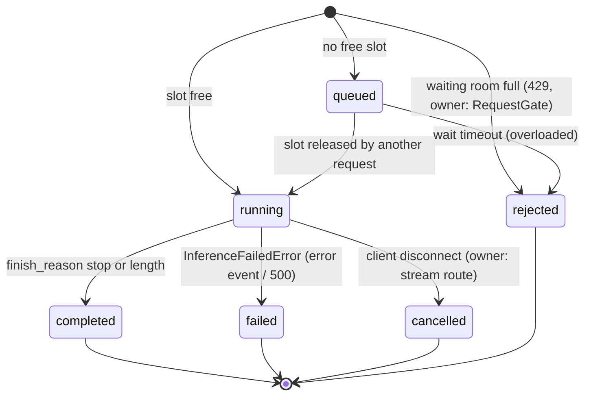

# INFERX HTTP API (v0.3.0)

> **Trust boundary.** There is **no authentication** in v0.3.0. Run the API on loopback or a trusted network only (default bind `127.0.0.1`). Do not expose it to the public internet. Identity and tenant isolation arrive in later releases (v3.3 / v4.0). The API is not production-ready.

Start (from `backend/`): `INFERX_AUTOLOAD_MODEL=true uv run uvicorn app.main:app --host 127.0.0.1 --port 8000` (needs `uv sync --extra ml`). Without autoload the model is not loaded and the POST routes return `409 model_not_loaded`.

The model is the configured, pinned one (`INFERX_MODEL_ID` / `INFERX_MODEL_REVISION`). **No request can choose a model.**

## Routes

| Route | Purpose |
|---|---|
| `GET /health` | Process liveness only; never checks the model |
| `GET /v1/model` | `{"loaded": bool, "model_id": str, "revision": str}` |
| `POST /v1/tokenize` | `{"prompt": str}` → `{"request_id", "token_count", "token_ids"}` |
| `POST /v1/generate` | Blocking generation, JSON response |
| `POST /v1/generate/stream` | Same request, Server-Sent Events response |

### Generate request

```json
{"prompt": "The capital of France is", "max_new_tokens": 16,
 "temperature": 0.8, "top_k": 40, "top_p": 0.9, "repetition_penalty": 1.0, "seed": 7}
```

Unknown fields are rejected. Sampling rules are those of `GenerationConfig` ([inference mechanics](inference-mechanics.md)): `temperature` 0 is greedy and cannot be combined with `top_k`/`top_p`.

### Generate response

`{"request_id", "text", "finish_reason", "prompt_tokens", "output_tokens", "metrics"}`. `finish_reason` is `stop` (end-of-sequence), `length` (`max_new_tokens` reached) or `cancelled`. `metrics` has a `value` and `provenance` per entry (`measured` or `derived_from_model_config`); TPOT and decode TPS are `null` for one output token.

## Streaming (SSE)

`Content-Type: text/event-stream`. Events:

```text
event: token
data: {"index":0,"text":" Paris"}

event: done
data: {"request_id":"…","finish_reason":"stop","prompt_tokens":5,"output_tokens":8,"metrics":{…}}
```

Rules: zero or more `token` events, then **exactly one** terminal event, `done` or `error` (the error envelope body), and nothing after it. `index` counts text deltas, not tokens, and a multi-byte character is never split across deltas. Failures before streaming starts (validation, model not loaded, overload) are ordinary JSON errors with the status codes below, not SSE.

## Errors

Always `{"error": {"code", "message", "request_id"}}`; `request_id` equals the `X-Request-ID` response header. Messages never echo prompt text.

| Status | `code` | When |
|---|---|---|
| 422 | `invalid_request` | schema or domain validation (unknown field, bad type, empty or too long prompt, `max_new_tokens` over limit, contradictory sampling) |
| 413 | `payload_too_large` | body over `INFERX_MAX_BODY_BYTES` |
| 409 | `model_not_loaded` | model not loaded |
| 429 | `overloaded` | all slots busy and the waiting room is full (`Retry-After: 1`); inside an already-started stream a wait timeout becomes an `error` event with this code |
| 500 | `inference_failed` | runtime failure during generation |
| 500 | `internal_error` | anything unexpected |
| 404 / 405 | `not_found` / `method_not_allowed` | unknown route / method |

## Request IDs

Every response has `X-Request-ID`. A client-supplied value is used only if it matches `^[A-Za-z0-9._-]{1,64}$`; otherwise a new 32-hex ID is generated. Logs carry the ID; they never carry prompts or generated text.

## Limits and concurrency

| Setting | Default | Meaning |
|---|---|---|
| `INFERX_MAX_PROMPT_CHARS` | 4000 | prompt length |
| `INFERX_MAX_NEW_TOKENS` | 256 | per-request output cap |
| `INFERX_MAX_BODY_BYTES` | 65536 | request body size |
| `INFERX_MAX_CONCURRENT_REQUESTS` | 1 | requests running at once |
| `INFERX_MAX_WAITING_REQUESTS` | 4 | requests allowed to wait for a slot |
| `INFERX_QUEUE_WAIT_TIMEOUT_S` | 30 | longest wait for a slot |

These bounds apply per process.

## Request lifecycle



A disconnect cancels generation at the next token and frees the slot. A request still waiting for a slot notices a disconnect only when its wait ends (at most `INFERX_QUEUE_WAIT_TIMEOUT_S`).

## Not supported yet

Authentication, per-user rate limits, model load/unload endpoints, cancel-by-ID, stop sequences, chat templates, persistence.
