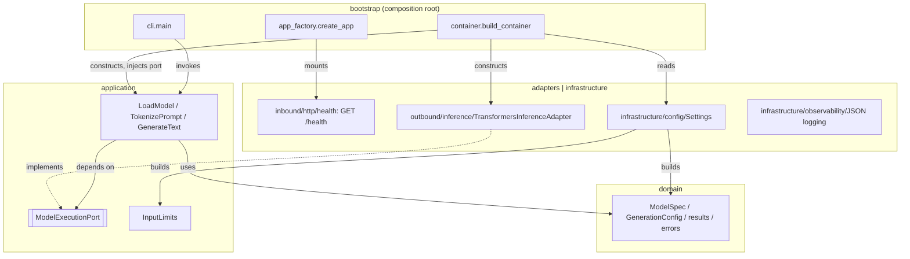
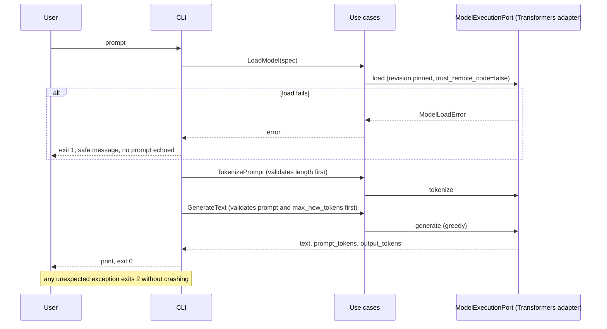

# v0.1.0 component graph (implemented)

Question answered: which module may depend on which, and what runs when a prompt is generated.
Source dependencies point inward and are enforced in CI by import-linter (`backend/pyproject.toml`).

## Generate flow (CLI, v0.1.0)

Not implemented yet (PLANNED): HTTP generate/tokenize/stream routes (v0.3.0), timing capture and sampling (v0.2.0), queue and worker lifecycle (v1.1+). `/health` reports process liveness only.
