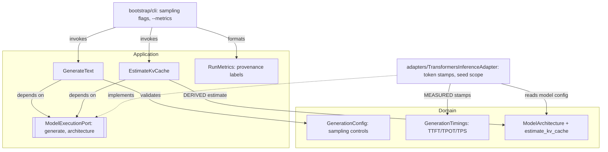

# v0.2.0 component graph (implemented)

Question answered: where timings, sampling and the KV estimate live, and which edges carry measured vs derived data. Layer rules are unchanged from [v0.1.0](v0.1.0-components.md) and enforced by import-linter.

Failure path: any runtime error inside `generate` or `architecture` becomes `InferenceFailedError`; the adapter stays usable afterwards (tested). Timing capture mismatch (stamp count != output tokens) is treated as a failure, not silently reported.
