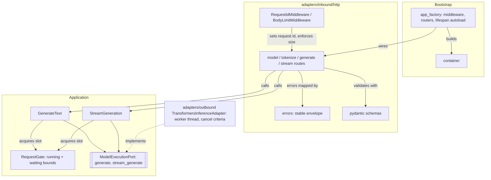

# v0.3.0 component graph (implemented)

Question answered: how an HTTP request reaches the model, and what happens on overload, failure and disconnect. Layer rules are unchanged (import-linter); routes read use cases from `app.state.api_deps`, populated only by the composition root.



## Streamed request, including failure paths

```mermaid
sequenceDiagram
  participant C as Client
  participant R as Stream route
  participant U as StreamGeneration
  participant G as RequestGate
  participant P as Port (Transformers adapter)
  C->>R: POST /v1/generate/stream
  R->>U: execute (validate, model loaded, check capacity)
  alt invalid / not loaded / full
    U-->>R: error
    R-->>C: JSON 422 / 409 / 429 (no SSE)
  else admitted
    R-->>C: 200 text/event-stream
    U->>G: acquire slot (waits up to timeout)
    U->>P: stream_generate(cancel)
    loop each text delta
      P-->>R: TokenDelta
      R-->>C: event: token
    end
    alt finished
      P-->>R: StreamFinished
      R-->>C: event: done
    else runtime error
      P-->>R: InferenceFailedError
      R-->>C: event: error (single terminal event)
    else client disconnects
      R->>P: cancel set, generator closed
      Note over R,G: slot released; no terminal event is sent to the departed client
    end
    U->>G: release slot
  end
```

Not implemented: authentication, cancel-by-ID, multi-process capacity sharing.
